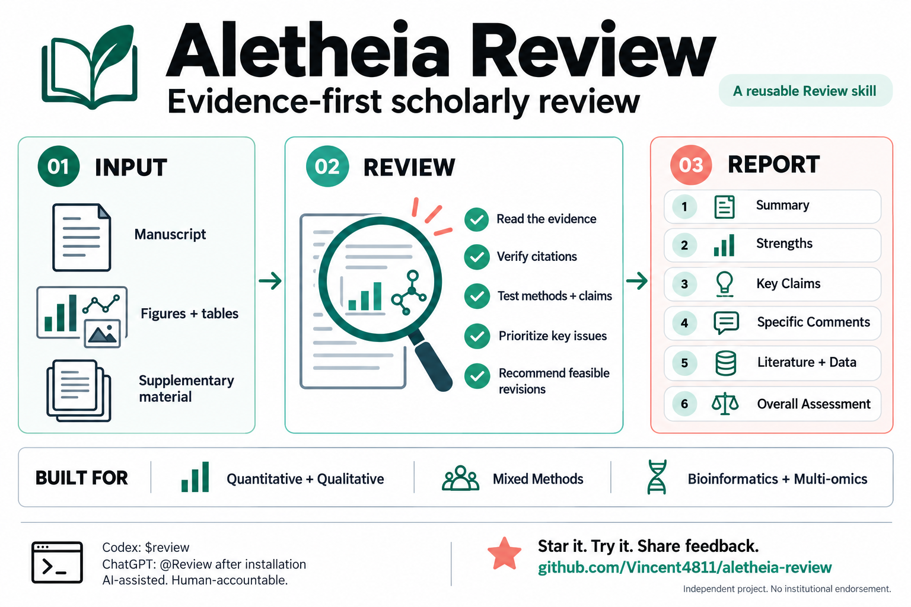

# Aletheia Review

**Evidence-first scholarly review.**



[View or download the full-size infographic](assets/aletheia-review-overview.png). AI-generated overview graphic, checked against the current skill instructions; not a performance benchmark.

A reusable agent skill for constructive academic manuscript review: verify the literature, locate the real problem, and give the author a practical way to resolve it.

The name evokes *aletheia*, a Greek term associated with truth and disclosure. The package is **Aletheia Review**; the skill stays **Review**, with the identifier **`review`**. This is not a claim that the name is legally exclusive.

## What It Does

- Reads the supplied manuscript and accessible supplements, including figures and tables when the host can inspect them.
- Searches relevant recent and foundational literature, close prior art, and rival explanations.
- Requires live verification of every external reference used in its report, with a DOI or original URL.
- Separates confirmed errors, plausible threats, reporting gaps, and unavailable evidence.
- Prioritizes manuscript-specific concerns with locations, consequences, feasible remedies, and resolution tests.
- Includes method-sensitive checks for quantitative, qualitative, mixed-methods, bioinformatics, multi-omics, computational, and evidence-synthesis work.
- Produces one author-facing report, not an editorial acceptance decision or a simulated three-reviewer panel.

This is an instruction-only skill, not an autonomous review service. It does not include a model, search subscription, API key, manuscript database, or MCP server. It uses the tools available in the host application.

## Install in Codex

Ask Codex's skill installer:

```text
$skill-installer Install skills/review from https://github.com/Vincent4811/aletheia-review.
```

Then invoke the installed skill:

```text
$review Review the attached manuscript and supplements. Verify relevant literature and return the six-section report in English.
```

Traditional Chinese is the default unless you request another language:

```text
$review 請審查附上的論文與補充資料，核對重要文獻，以繁體中文輸出正式審查意見。
```

Skill discovery and explicit invocation depend on the client. If a newly installed skill is missing, start a new session or restart the client. See the [official skill documentation](https://learn.chatgpt.com/docs/build-skills).

## Use in ChatGPT

This repository also includes a skills-only plugin manifest. Supported clients can package or install it as **Aletheia Review** and expose the bundled **Review** skill. After it is actually enabled, select **Review** from the `@` menu where supported.

Cloning this repository, attaching its ZIP to a chat, or installing it locally in Codex does **not** automatically install it in ChatGPT web, mobile, or another account. Local marketplace installation, workspace distribution, and availability vary by product and account. See [plugin packaging](https://developers.openai.com/plugins/build/plugins) and [installation testing](https://developers.openai.com/plugins/deploy/connect-chatgpt).

A textual `@Review` can be interpreted as an alias when these instructions are already loaded. That is not registration of a universal native mention. Do not assume a name typed in plain text has selected a skill.

## Report Structure

1. **Summary**: Research question, methods, claimed contribution, and material assessment limits.
2. **Strengths**: Specific, evidence-grounded strengths.
3. **Key Claims**: Prioritized central concerns, each with a manuscript location, evidence, significance, and feasible resolution.
4. **Specific Comments**: Useful secondary corrections with authentic locations.
5. **Literature and Data to Engage**: Verified references or datasets, linked to the relevant concern.
6. **Overall Assessment**: Ready to Submit, Minor Revisions, Major Revisions, or Rethink, with a short rationale. Incomplete central evidence may require a provisional or unassigned assessment.

Two or three high-value concerns are a prioritization target, not a quota. The skill must not invent defects to appear rigorous or inflate a local presentation issue into a fatal flaw.

## Privacy and Scientific Boundaries

Keep unpublished manuscripts, participant identifiers, distinctive confidential findings, and raw research data out of public repositories and external search queries. Review in the current environment does not authorize onward disclosure to another model, converter, or service. For confidential third-party peer review, establish permission and follow the applicable journal and institutional AI policy.

Do not assume an AI review verifies raw data, proves a causal mechanism, reproduces code, detects all image manipulation, or guarantees acceptance. When tools or source access are insufficient, the report must disclose that limitation rather than invent citations or completed analyses. Human authors remain responsible for scientific decisions.

## Package

```text
LICENSE
plugin.json
assets/aletheia-review-overview.png
skills/review/
  SKILL.md
  agents/openai.yaml
  references/method-specific-checks.md
  references/source-basis.md
examples/review-requests.md
docs/validation.md
```

## Provenance and Validation

The workflow draws on an author-provided academic reviewer prompt and the supplied Gary King and Steven Worthington paper, *AI Article Reviews Dominate Human Peer Reviews at Their Best: Evidence and Policy Choices*, including its discussion of constructive feedback and retrieval-supported reviewer prompting.

[Gary King](https://www.wcfia.harvard.edu/people/gary-king) is the Albert J. Weatherhead III University Professor at Harvard University; [Steven Worthington](https://www.iq.harvard.edu/people/steven-worthington-0) is Director of Data Science Services at Harvard's Institute for Quantitative Social Science. These links verify their institutional roles, not an endorsement of this project. The supplied PDF does not include the prompt appendices, so the Chinese prompt has not been verified as their verbatim original wording.

The original PDF is not redistributed. This is an independent implementation, not an official product of the paper's authors, Harvard, Nature, or OpenAI. See [source basis](skills/review/references/source-basis.md).

Metadata, reference paths, packaging, and disclosure checks have been tested. This is not a benchmark demonstrating review accuracy, superiority to human reviewers, or cross-client end-to-end performance. See [validation scope](docs/validation.md).

## Licensing

This project's original skill instructions, documentation and overview graphic are released under the [MIT License](LICENSE). Copyright (c) 2026 Vincent4811. Third-party papers and other external source material retain their own rights and are not relicensed by this repository.

If this workflow is useful, star the repository, try it on a manuscript you are authorized to process, and share grounded feedback through GitHub Issues. Check citations and substantive criticisms yourself before acting on an AI-generated review.
